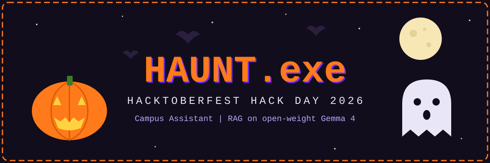

  

  
  
  

# 🎃 HAUNT.exe: Campus Assistant

> **Our submission for Hacktoberfest Hack Day 2026 by upGrad.**
> Theme: Open-Source AI and Open-Weight Models. Track: Theme 2, RAG Application with Gemma, problem 2A (Campus Regulations Assistant).

Rules hide in long PDFs. **HAUNT.exe** hunts them down. It is a chatbot that answers student questions about college regulations using only official documents. Every answer cites the college, document and page. If the documents do not cover the question, it declines and suggests contacting the college office.

Built entirely on open-weight models: **Gemma 4** writes the answers and **all-MiniLM-L6-v2** powers the search.

---

## 🕸️ How it works
1. 📄 PDFs are read and cut into chunks of about 120 words, each tagged with its college (SSIT or UGSOT, taken from the file name).
2. 🔮 Each chunk is turned into an embedding (all-MiniLM-L6-v2) and the index is saved to Google Drive, so documents are processed only once.
3. 🔦 A question is matched only against chunks of the chosen college, so two colleges never get mixed up.
4. 🧙 The top 3 chunks go to Gemma 4 (gemma-4-26b-a4b-it) through the Google AI Studio API, which answers with citations.
5. 🚪 If the best match is too weak, the bot declines instead of guessing.

## 🦇 Tech
Python, Google Colab, Gradio, pypdf, sentence-transformers, Gemma 4.

## 🕯️ How to run
1. Open `02_rag_starter_kit.ipynb` in Google Colab.
2. Create a free API key at [aistudio.google.com/apikey](https://aistudio.google.com/apikey) and add it in Colab Secrets as `GOOGLE_API_KEY` with Notebook access on.
3. Put your PDFs in a Google Drive folder named `campus_pdfs`, named like `ssit_rulebook.pdf` (college name, underscore, document name).
4. Run the cells in order. The app opens with a public link.

## ☠️ Limitations
- Scanned PDFs without selectable text cannot be read.
- Tables, such as faculty lists, can be read in a scrambled order.
- The free API key has a per-minute request limit.
- The public link works only while the Colab session is running.
- The college PDFs are not included in this repository.

---

<b>🎃 Built for Hacktoberfest Hack Day 2026 🎃</b>

